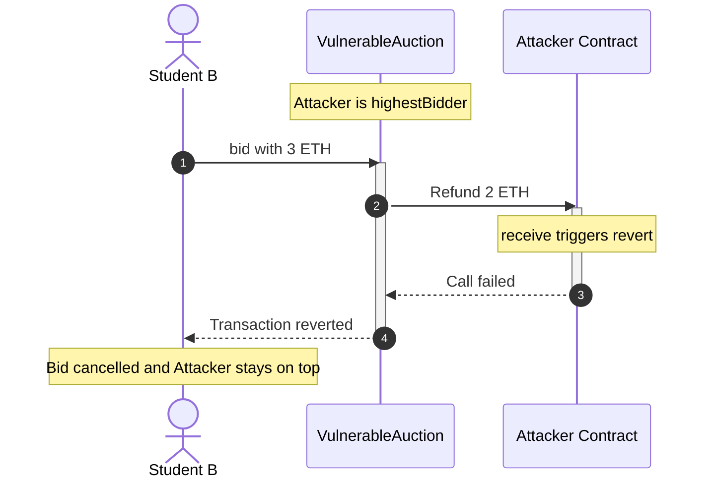
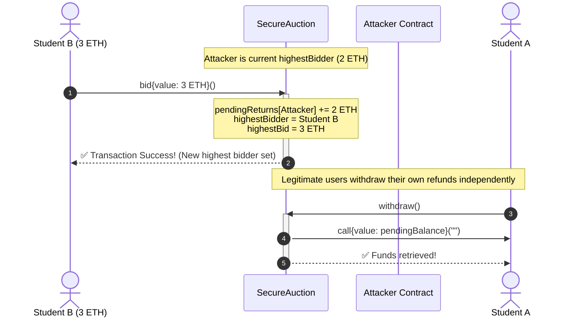
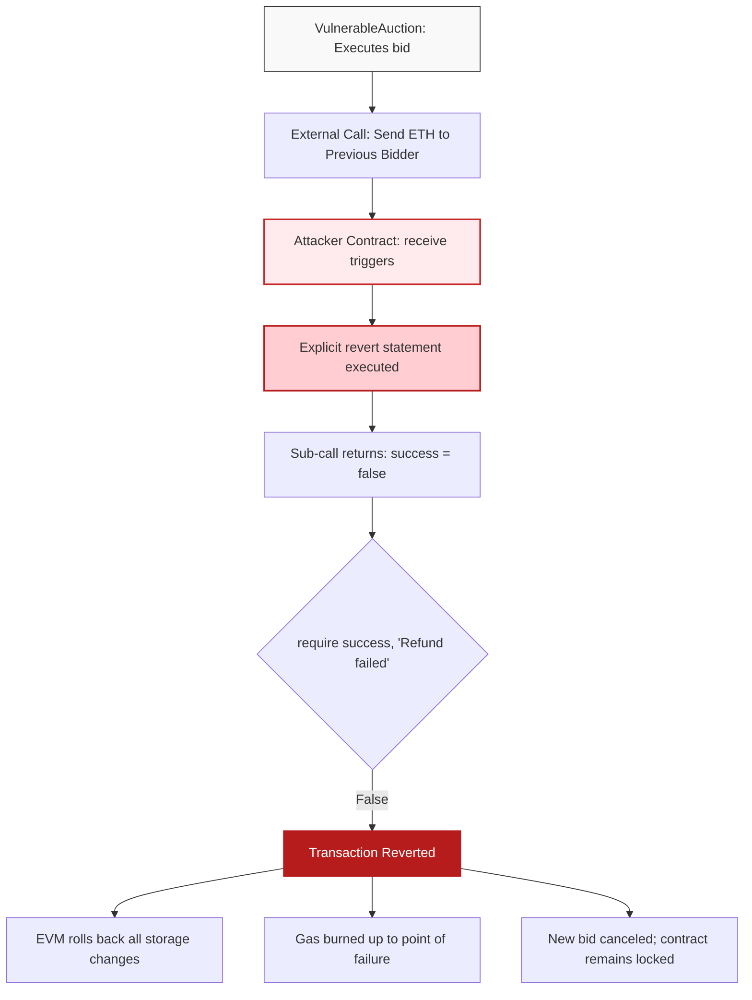
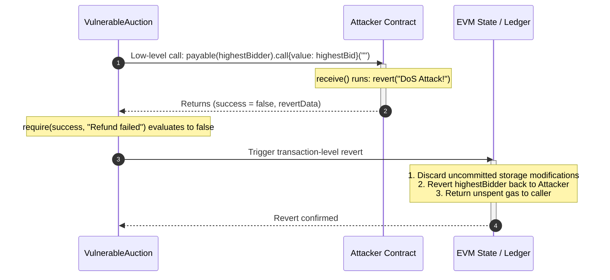

# Smart Contract Security: Denial of Service (DoS) via Unexpected Revert

A complete educational manual, architectural specification, and laboratory guide for demonstrating Denial of Service attacks in Ethereum smart contracts using Remix IDE.

---

## Table of Contents

1. [Core Concepts: What is a Smart Contract DoS?](https://www.google.com/search?q=%231-core-concepts-what-is-a-smart-contract-dos)
2. [The Vulnerability: Push vs. Pull Payments](https://www.google.com/search?q=%232-the-vulnerability-push-vs-pull-payments)
3. [Visualizing Attack & Defense (Mermaid Diagrams)](https://www.google.com/search?q=%233-visualizing-attack--defense-mermaid-diagrams)
* [3.1 Push Payment Failure Sequence](https://www.google.com/search?q=%2331-push-payment-failure-sequence)
* [3.2 Pull Payment Resolution Sequence](https://www.google.com/search?q=%2332-pull-payment-resolution-sequence)
* [3.3 EVM Call Stack & Revert Flow](https://www.google.com/search?q=%2333-evm-call-stack--revert-flow)


4. [Source Code Implementation](https://www.google.com/search?q=%234-source-code-implementation)
* [4.1 VulnerableAuction.sol](https://www.google.com/search?q=%2341-vulnerableauctionsol)
* [4.2 Attacker.sol](https://www.google.com/search?q=%2342-attackersol)
* [4.3 SecureAuction.sol](https://www.google.com/search?q=%2343-secureauctionsol)


5. [Classroom Laboratory Walkthrough (Remix IDE)](https://www.google.com/search?q=%235-classroom-laboratory-walkthrough-remix-ide)
* [Phase A: Deploying and Exploiting the Vulnerable Contract](https://www.google.com/search?q=%23phase-a-deploying-and-exploiting-the-vulnerable-contract)
* [Phase B: Testing the Resilient Pull Pattern](https://www.google.com/search?q=%23phase-b-testing-the-resilient-pull-pattern)


6. [Why Did It Revert? Deep Dive into the EVM](https://www.google.com/search?q=%236-why-did-it-revert-deep-dive-into-the-evm)
7. [Student Summary & Best Practices](https://www.google.com/search?q=%237-student-summary--best-practices)

---

## 1. Core Concepts: What is a Smart Contract DoS?

In traditional web infrastructure, a **Denial of Service (DoS)** attack typically entails flooding a server with millions of junk requests until network bandwidth saturates or hardware resources crash.

In smart contract architecture, **DoS operates on code logic and execution rules**:

* A smart contract cannot physically crash; its byte-code runs on all participating nodes in the decentralized network.
* If a critical operation in a function encounters an unhandled exception or an explicit `revert()`, the Ethereum Virtual Machine (EVM) **reverts the entire transaction**.
* If an attacker can manipulate contract state so that a required step permanently fails for all subsequent users, the contract is rendered completely frozen.

---

## 2. The Vulnerability: Push vs. Pull Payments

| Design Pattern | Mechanism | Security Posture |
| --- | --- | --- |
| **Push Payment (Anti-pattern)** | The contract automatically forwards native ETH to an external address during the execution of a primary business action (`bid()`). | **Vulnerable.** If the recipient address is a smart contract programmed to revert on transfer, the caller's entire transaction fails. |
| **Pull Payment (Industry Standard)** | The contract modifies an internal balance accounting mapping. Users independently call an isolated function (`withdraw()`) to claim their funds. | **Secure.** A malicious recipient can only block their own withdrawal; core contract operations remain open to everyone else. |

---

## 3. Visualizing Attack & Defense (Mermaid Diagrams)

### 3.1 Push Payment Failure Sequence

When Student B attempts to place a new bid, the auction contract executes an external call to refund the Attacker. The Attacker's fallback function deliberately reverts, which cascades and cancels Student B's bid.



---

### 3.2 Pull Payment Resolution Sequence

Under the Pull pattern, bidding only updates internal storage mappings. All external value transfers are completely isolated into individual withdrawals.



---

### 3.3 EVM Call Stack & Revert Flow

This flowchart details how the EVM enforces atomicity across the call boundary when a sub-call fails.



---

## 4. Source Code Implementation

Save each contract in its own dedicated file in your Remix IDE workspace:

### 4.1 `VulnerableAuction.sol`

```solidity
// SPDX-License-Identifier: MIT
pragma solidity ^0.8.20;

contract VulnerableAuction {
    address public highestBidder;
    uint256 public highestBid;

    function bid() external payable {
        require(msg.value > highestBid, "Bid too low");

        // VULNERABILITY (Push Payment):
        // Automatically refunding the previous bidder during bid execution.
        // If highestBidder rejects the transfer, the entire bid() function reverts!
        if (highestBidder != address(0)) {
            (bool success, ) = payable(highestBidder).call{value: highestBid}("");
            require(success, "Refund failed");
        }

        highestBidder = msg.sender;
        highestBid = msg.value;
    }
}

```

---

### 4.2 `Attacker.sol`

```solidity
// SPDX-License-Identifier: MIT
pragma solidity ^0.8.20;

interface IAuction {
    function bid() external payable;
}

contract Attacker {
    // 1. Enter the target auction and take the highestBidder spot
    function attack(address _target) external payable {
        IAuction(_target).bid{value: msg.value}();
    }

    // 2. Reject all incoming ETH transfers.
    // Whenever an external contract attempts to send ETH here, this reverts.
    receive() external payable {
        revert("DoS Attack: I refuse refunds! Auction is permanently locked.");
    }
}

```

---

### 4.3 `SecureAuction.sol`

```solidity
// SPDX-License-Identifier: MIT
pragma solidity ^0.8.20;

contract SecureAuction {
    address public highestBidder;
    uint256 public highestBid;

    // Internal accounting ledger: tracks refund credits per address
    mapping(address => uint256) public pendingReturns;

    function bid() external payable {
        require(msg.value > highestBid, "Bid too low");

        // SECURE (Pull Pattern):
        // Record the refund in storage. Zero external calls!
        if (highestBidder != address(0)) {
            pendingReturns[highestBidder] += highestBid;
        }

        highestBidder = msg.sender;
        highestBid = msg.value;
    }

    // Independent withdrawal function: users claim their own funds
    function withdraw() external {
        uint256 amount = pendingReturns[msg.sender];
        require(amount > 0, "No funds to withdraw");

        // Checks-Effects-Interactions: clear balance before sending ETH
        pendingReturns[msg.sender] = 0;

        (bool success, ) = payable(msg.sender).call{value: amount}("");
        require(success, "Withdrawal failed");
    }
}

```

---

## 5. Classroom Laboratory Walkthrough (Remix IDE)

### Setup

1. Open [Remix IDE](https://remix.ethereum.org/).
2. Create the three files (`VulnerableAuction.sol`, `Attacker.sol`, and `SecureAuction.sol`) under the `contracts/` directory.
3. Open the **Solidity Compiler** tab and ensure the compiler version is `0.8.20` or higher. Compile each file (`Ctrl+S` / `Cmd+S`).
4. Go to the **Deploy & Run Transactions** tab and set **Environment** to `Remix VM (Cancun)`.

---

### Phase A: Deploying and Exploiting the Vulnerable Contract

```
Step 1: Deploy VulnerableAuction
Step 2: Account 1 bids 1 ETH  ------> Account 1 is highestBidder
Step 3: Attacker bids 2 ETH   ------> Attacker is highestBidder
Step 4: Account 3 bids 3 ETH  ------> 💥 REVERT! DoS Active

```

1. **Deploy `VulnerableAuction`:**
* In the **Contract** dropdown, choose `VulnerableAuction` and click **Deploy**.


2. **Student A Places a Valid Bid:**
* Switch to **Account 1** (`0x5B3...`).
* Set **Value**: `1`, Unit: `Ether`.
* Click `bid`.
* Click `highestBidder` to inspect: it returns Account 1's address.


3. **The Attacker Claims the Lead:**
* Switch to **Account 2** (`0xAb8...`).
* In the **Contract** dropdown, select `Attacker` and click **Deploy**.
* Copy the deployed address of `VulnerableAuction`.
* In the deployed `Attacker` panel, paste the address into the `_target` input box of `attack`.
* Set **Value**: `2`, Unit: `Ether`.
* Click `attack`.
* Check `highestBidder` on `VulnerableAuction`: it now displays the address of the `Attacker` contract.


4. **Student B Tries to Bid (DoS Lockout):**
* Switch to **Account 3** (`0x4B2...`).
* Set **Value**: `3`, Unit: `Ether`.
* Click `bid` on `VulnerableAuction`.
* **Console Output:** The transaction reverts:
```text
transact to VulnerableAuction.bid errored: VM error: revert.
revert: DoS Attack: I refuse refunds! Auction is permanently locked.

```


* **Result:** No account can ever outbid the contract. `VulnerableAuction` is permanently bricked.


---

### Phase B: Testing the Resilient Pull Pattern

```
Step 1: Deploy SecureAuction
Step 2: Account 1 bids 1 ETH  ------> Account 1 is highestBidder
Step 3: Attacker bids 2 ETH   ------> Attacker is highestBidder
Step 4: Account 3 bids 3 ETH  ------> ✅ SUCCESS! Account 3 is highestBidder
Step 5: Account 1 withdraws   ------> ✅ Account 1 gets 1 ETH back

```

1. **Deploy `SecureAuction`:**
* In the **Contract** dropdown, select `SecureAuction` and click **Deploy**.


2. **Account 1 Bids:**
* Using **Account 1**: Set Value to `1 Ether`, click `bid`.


3. **Attacker Bids via `attack`:**
* Copy the address of `SecureAuction`.
* Paste it into the `_target` input of the already-deployed `Attacker` contract.
* Using **Account 2**: Set Value to `2 Ether`, click `attack`.
* Check `highestBidder`: it is now the `Attacker` contract address.


4. **Account 3 Bids:**
* Switch to **Account 3**: Set Value to `3 Ether`, click `bid`.
* **Result:** Transaction **succeeds**. Account 3 is now `highestBidder`.


5. **Withdraw Refund:**
* Switch back to **Account 1**.
* Pass Account 1's address into `pendingReturns`: it returns `1000000000000000000` (1 ETH).
* Click `withdraw`. Account 1 receives their 1 ETH refund.
* If the Attacker tries calling `withdraw()`, only the Attacker's personal transaction fails. The core contract remains unblocked.


---

## 6. Why Did It Revert? Deep Dive into the EVM



1. **EOAs vs. Smart Contracts:** An Externally Owned Account (EOA) has no code and accepts ETH automatically. Smart contracts execute arbitrary logic upon receiving ETH via `receive()` or `fallback()`.
2. **Transaction Atomicity:** Transactions on Ethereum are atomic: either every instruction succeeds, or every storage change is discarded. When `require(success)` evaluates to `false`, the entire transaction unwinds.
3. **Control Inversion Risk:** Coupling an external call to state advancement lets an untrusted recipient dictate whether that state advancement is allowed to finalize.

---

## 7. Summary & Best Practices

1. **Favor Pull Over Push for Payments:** Never send native ETH to arbitrary addresses inside core functions. Record balances in a `mapping(address => uint256)` and let users pull their funds independently.
2. **Follow Checks-Effects-Interactions (CEI):** In any withdrawal routine, zero out the caller's recorded balance *before* executing the transfer to protect against reentrancy attacks.
3. **Isolate Failure Domains:** When interacting with untrusted external contracts, assume the call can fail, consume all forwarded gas, or revert. A single external entity should never possess the leverage to block other users.