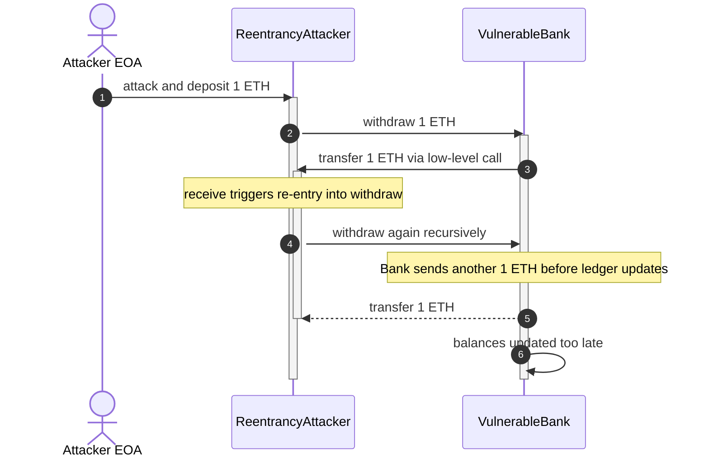
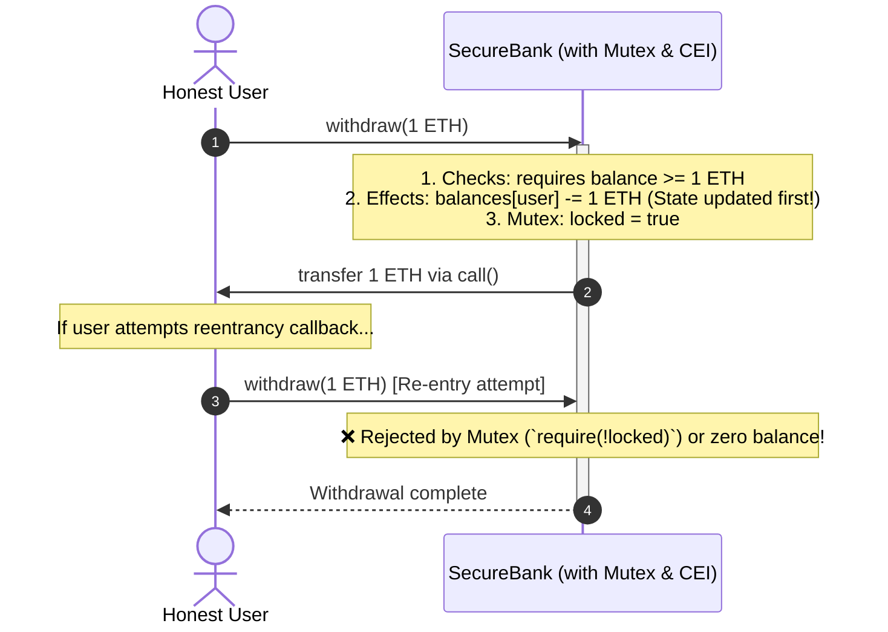

# Smart Contract Security: Reentrancy Attack & Defense

A complete educational manual, architectural specification, and hands-on laboratory guide for demonstrating Reentrancy vulnerabilities and secure mitigation patterns in Ethereum smart contracts using Remix IDE.

---

## Table of Contents

1. [Core Concepts: What is a Reentrancy Attack?](https://www.google.com/search?q=%231-core-concepts-what-is-a-reentrancy-attack)
2. [The Architectural Flaw: State Updates vs. External Calls](https://www.google.com/search?q=%232-the-architectural-flaw-state-updates-vs-external-calls)
3. [Visualizing Attack & Defense (Diagrams)](https://www.google.com/search?q=%233-visualizing-attack--defense-mermaid-diagrams)

* [3.1 Reentrancy Attack Sequence](https://www.google.com/search?q=%2331-reentrancy-attack-sequence)
* [3.2 Secure Resolution: Checks-Effects-Interactions & Mutex](https://www.google.com/search?q=%2332-secure-resolution-checks-effects-interactions--mutex)

4. [Contract Architecture Overview (Conceptual Breakdown)](https://www.google.com/search?q=%234-contract-architecture-overview-conceptual-breakdown)
5. [Complete Hands-On Remix IDE Lab Guide](https://www.google.com/search?q=%235-complete-hands-on-remix-ide-lab-guide)

* [Step 1: Workspace & Compiler Setup](https://www.google.com/search?q=%23step-1-workspace--compiler-setup)
* [Step 2: Deploying the Target Bank & Depositing Funds](https://www.google.com/search?q=%23step-2-deploying-the-target-bank--depositing-funds)
* [Step 3: Deploying the Attacker Contract](https://www.google.com/search?q=%23step-3-deploying-the-attacker-contract)
* [Step 4: Executing the Reentrancy Exploit & Draining the Vault](https://www.google.com/search?q=%23step-4-executing-the-reentrancy-exploit--draining-the-vault)
* [Step 5: Deploying & Verifying the Secure Fix (`SecureBank`)](https://www.google.com/search?q=%23step-5-deploying--verifying-the-secure-fix-securebank)

6. [Why Did It Drain? Deep Dive into the EVM Execution Stack](https://www.google.com/search?q=%236-why-did-it-drain-deep-dive-into-the-evm-execution-stack)
7. [Real-World Case Study: The DAO Hack (2016)](https://www.google.com/search?q=%237-real-world-case-study-the-dao-hack-2016)
8. [Summary & Best Practices](https://www.google.com/search?q=%238-summary--best-practices)

---

## 1. Core Concepts: What is a Reentrancy Attack?

A **Reentrancy attack** occurs when a smart contract makes an external call to an untrusted address *before* it updates its internal state ledger.

* **The Analogy:** Imagine visiting an ATM machine, requesting a withdrawal of $100, and the machine immediately pushes physical cash out of the slot *before* subtracting $100 from your bank account balance. If you are fast enough, you can press the withdraw button over and over again before the machine's computer has a chance to update your balance.
* **In Smart Contracts:** The attacker exploits the Ethereum Virtual Machine's (EVM) ability to call back into a function before the previous execution finishes, completely bypassing balance checks and draining the contract.

---

## 2. The Architectural Flaw: State Updates vs. External Calls

In Solidity, sending native ETH requires interacting with an external address via low-level calls (`msg.sender.call{value: amount}("")`).

* When you send ETH to a smart contract, that recipient contract's `receive()` or `fallback()` function instantly executes.
* If the withdrawal function sends ETH **before** decrementing the user's balance in storage (`balances[msg.sender] -= amount`), the malicious receiver can re-enter the withdrawal function while their balance still appears fully intact.

---

## 3. Visualizing Attack & Defense (Diagrams)

### 3.1 Reentrancy Attack Sequence

---

### 3.2 Secure Resolution: Checks-Effects-Interactions & Mutex

---

## 4. Contract Architecture Overview (Conceptual Breakdown)

To execute this laboratory, students interact with three distinct structural components:

1. **`VulnerableBank.sol` (The Target):** A basic vault that lets users deposit and withdraw ETH. Its flaw lies in executing `msg.sender.call{value: _amount}("")` *before* executing `balances[msg.sender] -= _amount`.
2. **`ReentrancyAttacker.sol` (The Exploit):** A malicious contract featuring a custom `receive()` fallback handler. When it receives the refunded ETH, its fallback function automatically invokes `bank.withdraw()` again, creating an unyielding recursive loop until the vault is emptied of all liquidity.
3. **`SecureBank.sol` (The Solution):** Implements two vital defenses:

* **Checks-Effects-Interactions (CEI):** Updates the internal state (`balances[msg.sender] -= amount`) *prior* to initiating any external ETH transfer.
* **Mutex Lock (Reentrancy Guard):** A boolean modifier (`locked`) that locks execution entry upon function call and unlocks it only after completion, completely blocking recursive entry.

---

## 5. Complete Hands-On Remix IDE Lab Guide

This step-by-step walkthrough allows students to deploy the contracts, execute the exploit, and verify the defense inside [Remix IDE](https://remix.ethereum.org/).

### Step 1: Workspace & Compiler Setup

1. Open [Remix IDE](https://remix.ethereum.org/) in your web browser.
2. Create three separate files in your file explorer:

* `VulnerableBank.sol`
* `ReentrancyAttacker.sol`
* `SecureBank.sol`

3. Go to the **Solidity Compiler** tab on the left sidebar:

* Set the compiler version to **`0.8.20`** or higher.
* Compile all three files and verify green checkmarks appear.

---

### Step 2: Deploying the Target Bank & Depositing Funds

1. Navigate to the **Deploy & Run Transactions** tab.
2. Set **Environment** to `Remix VM (Cancun)`.
3. Select **Account 1** from the **Account** dropdown (representing an honest user holding 100 ETH).
4. Select **`VulnerableBank`** from the **Contract** dropdown and click orange **Deploy**.
5. **Deposit Honest Funds:**

* Expand `VULNERABLEBANK` under **Deployed Contracts**.
* In the top-left **Value** box, type `5` and select **`Ether`**.
* Click orange **`deposit`**.
* Click blue **`getBalance`**: verify it returns `5000000000000000000` (5 ETH).

---

### Step 3: Deploying the Attacker Contract

*Important Note on Constructors:* The `ReentrancyAttacker` contract takes the bank's address in its constructor. Because the constructor is **not payable**, you must leave the deployment value at **0**.

1. Switch to **Account 2** in the **Account** dropdown (representing the Attacker).
2. Select **`ReentrancyAttacker`** from the **Contract** dropdown.
3. Copy the deployed contract address of `VULNERABLEBANK` from step 2.
4. Paste that address into the constructor input box (**`_bank`**) located right next to the orange **Deploy** button.
5. Ensure the top-left **Value** field is set to **`0`** (do not send ETH during deployment).
6. Click orange **Deploy**. Expand the newly created `REENTRANCYATTACKER` panel.

---

### Step 4: Executing the Reentrancy Exploit & Draining the Vault

1. Go back up to the top-left **Value** input box:

* Type **`1`** and select **`Ether`** (this is the initial 1 ETH required to seed the attack).

2. In the expanded `REENTRANCYATTACKER` section, click the orange **`attack`** button.
3. **Inspect the Result:**

* Scroll down to `VULNERABLEBANK` and click blue **`getBalance`**.
* **Result:** It now reads `0`! The attacker contract successfully recursively drained the entire vault (the honest user's 5 ETH plus the attacker's 1 ETH) in a single transaction.

---

### Step 5: Deploying & Verifying the Secure Fix (`SecureBank`)

1. Switch back to **Account 1** in the **Account** dropdown.
2. Select **`SecureBank`** from the **Contract** dropdown and click orange **Deploy**. Expand `SECUREBANK`.
3. **Deposit Honest Funds:**

* Set **Value** to `5 Ether`.
* Click `deposit` on `SECUREBANK`. (`getBalance` shows 5 ETH).

4. **Deploy a New Attacker for the Secure Bank:**

* Switch to **Account 2**.
* Select **`ReentrancyAttacker`** from the contract dropdown.
* Copy the deployed address of `SECUREBANK`, paste it into the `_bank` deployment input box, ensure Value is `0`, and click **Deploy**.

5. **Attempt the Attack:**

* Set **Value** to `1 Ether` in the top value box.
* Click orange **`attack`** on the new `REENTRANCYATTACKER` panel.
* **Inspect the Result:**
* The transaction **reverts** with an error (e.g., `Transfer failed` or `Reentrant call detected!`).
* Click `getBalance` on `SECUREBANK`: all funds remain 100% secure.

---

## 6. Why Did It Drain? Deep Dive into the EVM Execution Stack

1. **Control Flow Interruption:** When a contract executes an external `.call()`, control of the EVM thread is handed entirely over to the target receiver.
2. **Delayed State Mutation:** Because `balances[msg.sender] -= _amount` was written *after* the external call in `VulnerableBank`, the ledger remained unchanged while the receiver's fallback function was running.
3. **Gas Forwarding:** The low-level `.call{value: _amount}("")` forwards all remaining execution gas, enabling the attacker's contract to loop `withdraw()` repeatedly until the bank's balance drops to zero.

---

## 7. Real-World Case Study: The DAO Hack (2016)

The reentrancy vulnerability is not merely a theoretical construct; it is responsible for one of the most famous and catastrophic exploits in blockchain history.

* **Background:** Launched in April 2016, **The DAO** was a decentralized autonomous organization structured as a venture capital fund on Ethereum. It raised an unprecedented $150 million worth of Ether through a massive token sale, accumulating roughly **14% of all circulating ETH** at the time.
* **The Exploit:** On June 17, 2016, an attacker exploited a reentrancy flaw within The DAO's smart contract withdrawal and split logic. By executing recursive calls before internal balance tracking could decrement, the attacker siphoned **3.6 million ETH** (valued at approximately $60 million USD back then) into a child DAO.
* **The Impact & Resolution:** The exploit posed an existential threat to the one-year-old Ethereum network. To rescue the ecosystem from complete collapse, the Ethereum community controversially decided to execute a protocol-level **hard fork** to roll back the malicious transactions and recover the funds. This decision split the network into two distinct blockchains: **Ethereum (ETH)** and **Ethereum Classic (ETC)**.
* **Industry Takeaway:** The DAO hack permanently changed how smart contract developers approach architecture, cementing the **Checks-Effects-Interactions (CEI)** pattern and **Reentrancy Guards (`nonReentrant`)** as mandatory defensive standards across modern Web3 development.

---

## 8. Summary & Best Practices

1. **Apply Checks-Effects-Interactions (CEI):** Always validate inputs (`Checks`), update contract state variables (`Effects`), and only then perform external calls or token transfers (`Interactions`).
2. **Use Reentrancy Guards (Mutex Locks):** Implement modifiers like OpenZeppelin's `ReentrancyGuard` (`nonReentrant`) on all functions that handle asset transfers.
3. **Prefer Transfer/Send over Raw Calls When Appropriate:** While low-level `.call` is standard for modern Solidity, using built-in safety features and guards prevents recursive fallback abuse.